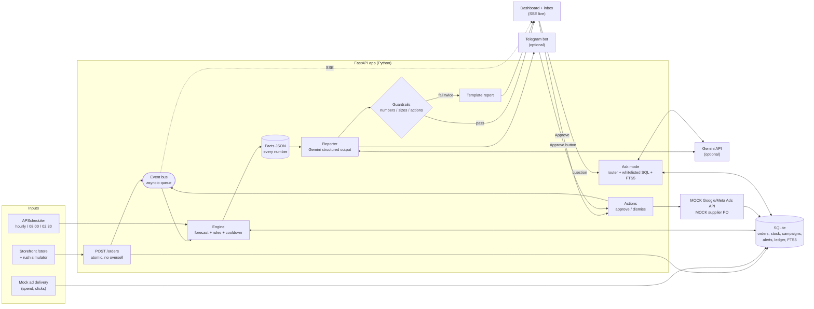

# SignalShift.ai

**Inventory-aware ad bidding assistant**, a working prototype for AIBuilderCup 2026 (Hack2skill).

Marketing systems and inventory systems don't talk to each other, so ads keep spending on products, and especially on *sizes*, that are about to sell out. SignalShift.ai connects live sales, size-level stock and ad campaigns:
- It estimates **when** a size will stock out and explains **why**.
- It recommends **what to do**: pause the ads, shift the budget, reorder.
- It sends the owner a short report, and **one tap on Approve** runs the plan.

> **Design rule:** code does the math, Gemini does the language. Every number is computed in Python. Gemini only turns a facts JSON into prose, and a guardrail checks every number it writes.

Demo business: **Solenest**, a fictional Indian D2C footwear and accessories brand heading into Diwali.
**All data is synthetic sample data**, not real benchmarks. The ad platform and supplier integrations are **mocks**.

## Quick start (one command)

```bash
pip install -r requirements.txt
python run.py            # builds the demo data on first run, then serves http://localhost:8080 (change with PORT)
```

The UI is **SignalShift.ai**, a single-page app that opens on a demo sign-in:
- **Owner** (`owner@solenest.in` / `demo123`): overview with business status, alerts, inventory, sales, campaigns, savings, Ask, and the notifications bell.
- **Customer** (`customer@demo.in` / `demo123`): *Ads for you* (random ads from the live campaigns) and the demo storefront.
- Switch between the two from the user menu (top right). Light/dark toggle and in-app Back/Forward buttons are in the top bar.
- `/docs`: API.

The sign-in is a client-side demo switch between the two views, not authentication.

It runs fully offline: no Gemini key means template reports, and no Telegram token means the in-app inbox only.

**Optional:** `cp .env.example .env` and add `GEMINI_API_KEY` and/or `TELEGRAM_BOT_TOKEN` + `TELEGRAM_CHAT_ID`. `python scripts/check_gemini.py` then does a live Gemini smoke test.

**Other commands:**

```bash
python scripts/generate_data.py --reset   # rebuild the demo data (seeded; --anchor 2026-10-15T10:00 for a fixed "now")
python scripts/run_replay.py              # counterfactual replay: with vs without SignalShift.ai
python -m pytest                          # 131 tests
```

## The 3-minute demo

Before the demo, sign in as the owner and click **Reset demo**. This rebuilds the history up to the current hour.
*Optional:* set `AD_SIM_SPEED=20` in `.env` so the spend counters move visibly.

1. **The hidden problem.**
   - On the inventory heatmap (Hero tab), Festive White Sneaker shows **160 pairs**, which looks healthy.
   - But **UK 9 has 4 left** (Low, about 16 h of cover) and UK 8 has 11. Its Google and Meta campaigns are live, and **68% of their clicks want UK 8/9** (the size click mix bar).
2. **A sale.** As the customer (user menu → *Switch to customer view*, Hero sneakers), buy **Festive White · UK 9**. The dashboard tiles and the UK 9 cell update instantly over SSE.
3. **The rush.** Press **⚡ Simulate rush**. Ten orders weighted to UK 8 and UK 9 arrive over about 15 s, and UK 9 and UK 8 drop into the red.
4. **The alert.** A **Critical** card arrives in the inbox (and on Telegram with Approve/Dismiss buttons, if configured), for example:
   > *UK 9 of Festive White Sneaker has 1 pair left and will sell out in about 1.1 h while 2 ad campaigns keep spending. 68% of the ad clicks are for UK 8 and UK 9.* It recommends pausing both campaigns, re-investing ₹2,000/day in Everyday Runner (about 22 days of cover) and ₹1,000/day in Canvas Low-Top, and reordering UK 8/9. It also shows the likely cover range and a *velocity spike* tag.
5. **Approve.**
   - The mock Ads API pauses the campaigns: "ads live" disappears and spend stops.
   - Budgets move, and a mock purchase order books the stock in transit.
   - The Savings tiles update with ad spend avoided and sales protected, each with an explanation.
6. **Ask.** Click *"How much ad spend did we save today?"*. The answer comes from a whitelisted query, and its evidence is shown.

**Bonus:**
- **Wasted spend from the shopper's side:** as the customer, open **Ads for you**. Ads come from the live campaigns, and each shows one size, picked by the campaign's size click mix. Whenever an advertised size is sold out, at least one ad for it is in the mix, and the ad does not say so. Click it: the store opens on that product with **"Stock not available"**. The click is charged at the campaign's CPC and recorded as wasted, so the owner's **Wasted on out-of-stock clicks** tile goes up at once, with a toast if the owner is watching. To have a sold-out size to show, sell out UK 9 first (Simulate rush, then buy the last pairs in the store). Pausing the campaign via Approve removes those ads.
- *"Why did you recommend pausing the white sneaker campaign?"* retrieves the alert and explains it.
- **Run replay** in Savings shows 30 days with vs without SignalShift.ai, scored against the hidden planted stockouts.

## Architecture



## Synthetic data

- 44 products and 227 size variants:
  - hero sneakers (Retro Runner '86, Festive White Sneaker, Chunky Trend)
  - core sneakers
  - last-season slow movers
  - accessories (socks, cleaning kit, backpack, cap)
- 2 years of orders (about 1.3 lakh) and hourly ad metrics for the last 30 days.
- Daily site events for the last 30 days.
- Demand = base × day-of-week × mild growth trend × festival multiplier × campaign uplift × noise.
- Size curve for UK 6–11: UK 8 + UK 9 ≈ 55% of footwear sales.
- **How inventory is simulated:** the generator walks backward from the exact demo state, inserting restock arrivals. As a result:
  - the stock ledger reconciles to `on_hand`
  - stock never goes negative
  - the **only** stockouts are the planted ones
- **Diwali preparedness:** most products have festive purchase orders in transit. The hero sneakers and the gift box are deliberately under-stocked for Diwali, which drives the Opportunity alerts.
- **Hidden truth:** 5 hero variants stock out while their campaigns are live. They are recorded in `ground_truth`. The engine never reads this table; only the replay uses it, to measure precision and recall.
- **Demo state:**
  - Festive White Sneaker has 160 pairs in total, but UK 9 has only 4 and UK 8 has 11. Its Google and Meta campaigns are live, and 68% of clicks ask for UK 8/9.
  - Everyday Runner has about 22 days of cover and is the budget-shift target.

Generator options:
- `--seed N` (default 2026)
- `--anchor 2026-10-15T10:00` sets the demo's "now". The default is the current hour in IST.
- `--db path`

The same seed and anchor always produce the same database.

### ⚠️ Verify the festival calendar

Dates for Navratri/Dussehra, Dhanteras, Diwali, Raksha Bandhan and the other events are in [app/data/calendar_in.json](app/data/calendar_in.json). Hindu festival dates follow the lunar calendar and differ by region. Check them against an official panchang or the government holiday list before relying on them. Edit the JSON and re-run the generator to apply changes.

## Order pipeline

- **`POST /orders`** takes `{"items": [{"sku", "qty"}], "channel", "city", "idempotency_key"?}`.
  - Each line runs a conditional `UPDATE … WHERE on_hand - reserved >= qty` inside one SQLite `BEGIN IMMEDIATE` transaction.
  - If any line can't be filled, the whole order rolls back, so stock can never be oversold.
  - Errors: `404 unknown_sku`, `409 insufficient_stock` (includes how many are available), `422` for invalid input.
  - Sending the same `idempotency_key` twice returns the original order instead of creating a new one.
- **Event bus** ([app/services/events.py](app/services/events.py)):
  - An asyncio queue and consumer. `publish()` is thread-safe.
  - The consumer handles each order event once, even if it is delivered twice.
  - Each order event triggers the engine for **only the variants in that order**, plus sizes of that product that already have an open alert (see *Keeping open alerts accurate*).
- **`GET /stream`** (Server-Sent Events): pushes live events with a keep-alive every 15 s. A browser that reconnects with `Last-Event-ID` gets the events it missed.
- **`/store`**: the demo storefront. Click a size to buy one pair. Stock counts and today's sales update live over SSE.

## Forecast and rules

**Code does the math.** Every figure in an alert comes from [forecast.py](app/services/forecast.py) and [engine.py](app/services/engine.py) and is stored in a `Facts` model ([schemas.py](app/schemas.py)).

```
available      = on_hand - reserved
demand_per_hr  = base_velocity × seasonal_uplift × campaign_uplift × size_mix_factor
hours_of_cover = available / demand_per_hr        (rounded down, never overstated)
stockout_eta   = now + hours_of_cover
```

| Input | How it is computed |
|---|---|
| `base_velocity` | Product-level, exponentially weighted average of hourly sales over 14 days (72 h half-life). Each hour is first divided by the festival and campaign factors in force at the time, so those effects aren't counted twice. |
| `seasonal_uplift` | The calendar multiplier, scaled by a per-category factor learned from past festivals. |
| `campaign_uplift` | Learned per campaign: a regression of daily sales on days the campaign was on vs. off, over the last 60 days. |
| `size_mix_factor` | The size's share of the product's sales over 90 days, smoothed toward its 2-year share. |
| Confidence band | ± the day-to-day variation of the last 14 days (15–50%). The facts carry low, expected and high cover. |
| Rush detection | If a size's sales over the last 2 h run above 2× forecast (and at least 3 units), it is flagged as `velocity_spike` and the demand estimate moves halfway to the observed rate. |

Learned factors are written to `forecast_factors` by the nightly recalibration (also `POST /engine/recalibrate`).

**Rules** (all thresholds in `.env` / [config.py](app/config.py)):
- **Critical:** cover < `AD_PAUSE_LAG_HOURS` (4 h) **and** an active campaign targets the product.
- **Warning:** projected stockout comes before restock. Restock means the in-transit ETA; without one, lead time + 2 days. An overdue ETA is treated as a delayed restock.
- **Opportunity** (per product): a festival starts within 30 days, and projected demand through its end exceeds available plus in-transit stock. It recommends a reorder of the shortfall + 10%, per size.
- **Size-aware clicks:** at-risk click share = the campaign's clicks for sizes that are low (< 24 h) or out.
  - 60% or more at risk → pause the campaign.
  - Less than that → cut the at-risk share of its budget.
- **Wasted spend:** `clicks_per_hr × avg_cpc × size click share × hours the ad stays live after that size sells out`. This is bounded by restock or 72 h, whichever comes first.
- **Budget shift:** other products with an active campaign are ranked by `expected_roas × margin`. A candidate only qualifies if:
  - it has at least 14 days of cover and enough to last through its own upcoming festival
  - none of its sizes are at risk

  The freed budget is split by score, each target gets at most +100% of its budget, and anything left over is held back.
- **Cooldown:** 6 h per variant. A new alert is allowed inside the cooldown only on escalation (higher severity) or if cover drops by more than 30%. Opportunity alerts are per product and never re-fire inside the cooldown.

**Triggers:**
- **Event-driven:** each order evaluates only the variants in it. A `campaign` event with status `active` re-evaluates that product. An approval or dismissal re-checks that product.
- **Scheduled** (APScheduler, IST):
  - hourly refresh of products with live campaigns, plus a delayed-restock check
  - 08:00 daily briefing (a `briefing` event)
  - 02:30 recalibration
- **Startup:** calibrates if needed, then runs a full sweep in the background.

Every alert decision (alert / refreshed / suppressed / expired) is logged as a JSON line with the full facts.

## Gemini report and guardrails

**Gemini does the language, and only the language.** [reporter.py](app/services/reporter.py) sends Gemini the `Facts` JSON plus pre-formatted display strings (for example "₹2,600/day", "1.1 h", "68%"). It asks for a structured `Report`: `headline`, `summary`, `why` (2–3 reasons), `recommendations` (each tied to an engine action type) and `estimated_impact`.

- **API:** `google-genai` `generate_content` with `response_mime_type="application/json"` and `response_json_schema=Report.model_json_schema()`.
  - Model names come only from `GEMINI_MODEL` / `GEMINI_FALLBACK_MODEL`. `.env.example` suggests the stable `gemini-3.8-flash` / `gemini-3.5-flash-lite`, checked on 2026-10-15 against <https://ai.google.dev/gemini-api/docs/models>; verify they are still current.
  - The newer Interactions API was not used because it stores requests server-side by default.
- **System prompt rules:**
  - use only numbers from the facts, and never compute, convert or estimate new ones
  - never change the severity
  - only mention sizes and products that are in the facts
  - follow the engine's actions in order
  - write short, plain, assistant-like prose
- **Guardrails** ([guardrails.py](app/services/guardrails.py)): every number, ₹ amount, percentage and duration in the text must match the facts.
  - **Unit-aware:** a % must match a share; hours, days and minutes must match a duration (with conversions such as 72 h ↔ 3 days); ₹ must match a money field.
  - **Tolerance:** within 2%, or rounded or rounded down to a whole number. Never rounded up.
  - **Entities:** sizes and catalog products must be in the facts.
  - **Actions:** recommendation types must be among the engine's actions.
- **Which path produces the report** (logged, and stored in `alerts.report_source`):
  - `gemini`: the primary model's output passed, possibly after one retry that lists the violations.
  - `gemini_fallback_model`: the primary model errored or returned invalid JSON, and the fallback model's output passed.
  - `template`: no key or model configured, both models errored, or the output failed the guardrails twice. The report is then built deterministically from the facts. Template reports pass the same guardrails (tested for every demo alert).
- **Delivery to the inbox:** the template report is written the moment an alert is created, so the inbox is never empty. If a key is configured, a background worker then upgrades it with Gemini. Background failures are logged.

## Dashboards and owner inbox

`/dashboard` is a single page (HTML, vanilla JS, Plotly). It loads the read APIs once and then stays live over SSE.

| Section | Contents |
|---|---|
| **Tiles** | orders and revenue today, ad spend today, ₹ wasted on out-of-stock clicks (today and last 30 days), open alerts, ad spend avoided |
| **Ask** | question box with example questions; each answer shows its evidence |
| **Sales** | orders per hour (today as bars, yesterday as a dotted line, one axis) and top products today |
| **Inventory** | size heatmap per product (units available + cover, coloured Out / Low < 24 h / Runs out before restock / OK, each with a label) and a "sizes at risk" table. Both are sorted by quantity, lowest first (switchable to highest first or name). The heatmap shows the hero insight at a glance: Festive White has 160 pairs, but UK 9 is nearly gone. |
| **Sales page** | every order (server-side paging, newest first; search by order #, SKU, product, size or city; filter by period and channel; new orders appear live), plus a per-SKU 3-month trend: units in each 30-day window, a 13-week sparkline, change vs the prior 30 days, and a daily chart for any SKU you click |
| **Ads for you** (customer) | 8 random ads from active campaigns (mock ad serving). A click is charged to the campaign's current hour like the ad simulator, recorded as wasted when the size has nothing available, and lands on the store with that product and size highlighted. A sold-out size shows "Stock not available". |
| **Campaigns** | status, budget, spend, clicks and wasted spend today. Each campaign's size click mix is shown as a segmented bar coloured by each size's stock status. |
| **Inbox** | alert cards with severity, report, likely cover range, anomalies, who wrote the text (Gemini or template), Approve / Dismiss, and who decided |
| **Savings** | ad spend avoided, sales protected, stockouts prevented, actions executed, ledger entries, and the counterfactual replay |

**Mock live ad delivery** ([ad_simulator.py](app/services/ad_simulator.py)): the seeded ad metrics stop at the data snapshot. While the app runs, a clearly labelled **mock** accrues spend and clicks every 30 s for active campaigns, following budget and time of day. Clicks for out-of-stock sizes are recorded as wasted. Set `AD_SIM_SPEED` (for example 20) so the counters move visibly during a short demo.

**Engineering notes:**
- **Offline:** Plotly is vendored (`app/web/vendor/plotly-basic.min.js`, v2.35.2), so the dashboard works without internet.
- **Rupee formatting:** amounts use Indian digit grouping (`en-IN`).
- **Escaping:** all server and Gemini text is HTML-escaped before rendering.
- **Colours:** the palette follows a validated reference palette (status colours always paired with a label; separate light and dark tokens).
- **Snapshot cost:** the stock snapshot that powers the heatmap reuses the engine's per-product context. It takes about 0.3 s, and concurrent requests share one computation.

## Delivery and actions

**Approve** ([actions.py](app/services/actions.py)) runs the alert's recommended actions in **one transaction** and records each in `actions`, with its request and response.

> ⚠️ **All executors are mocks.** Nothing contacts Google, Meta or a supplier.
> - `MockGoogleAdsApi` uses the request and response shapes of Google Ads `CampaignService.MutateCampaigns` (`status: PAUSED`, `update_mask`) and `CampaignBudgetService.MutateCampaignBudgets` (`amount_micros`).
> - `MockMetaAdsApi` mimics a Marketing API campaign update, with budgets in paise.
> - `MockSupplierApi` creates a purchase order, which books stock in transit with an ETA of the lead time.
>
> The local tables play the platform, so a mock pause really stops the mock ad simulator's spend, and a mock purchase order changes the engine's restock picture.

**What the actions do:**
- **Pause:** used when 60% or more of a campaign's clicks are at risk.
- **Shift budget:** each target gets its amount. Campaigns that keep running give up the at-risk share of their own budget.
- **Reorder:** books the per-size quantities as stock in transit.

**Savings ledger** (computed only from the alert's facts, with the explanation stored):
- **Ad spend avoided** = hourly spend on clicks for the at-risk sizes once out of stock × hours the ads would have run before restock, capped at 72 h. Counted only if an ad action ran.
- **Sales protected** = reorder quantity × price, i.e. projected demand the current stock cannot serve. Counted only if the reorder ran.

**Dismiss** records the decision. The alert keeps its cooldown, so the engine stays quiet for that size.

**Approving or dismissing twice** returns 409 and nothing runs again.

**Keeping open alerts accurate:**
- The cooldown limits *notifications*, not *freshness*. An open alert whose plan changes is refreshed in place: new facts, a regenerated report, and the Telegram message edited rather than re-sent. A plan changes when its at-risk sizes, actions or campaign recommendations change. For example, when UK 8 drops after UK 9's Critical, the plan changes from "trim budgets" (35% of clicks at risk) to "pause both campaigns" (68%).
- When an order or a decision touches a product, the engine also re-checks that product's sizes that have open alerts.
- While a higher-severity alert is cooling down, a lower severity never re-alerts.
- Open alerts whose condition no longer holds are **expired by the engine**. Examples: a Critical whose ads were paused by approving a sibling size's alert, a Warning whose cover now outlasts the restock, or an Opportunity whose shortfall is covered. This prevents stale plans, such as reordering the same stock twice.

**Delivery** ([delivery.py](app/services/delivery.py)):
- **In-app inbox:** always on. The alert row and its report *are* the inbox, pushed live over SSE.
- **Telegram:** used when `TELEGRAM_BOT_TOKEN` and `TELEGRAM_CHAT_ID` are set.
  - Alerts at or above `TELEGRAM_MIN_SEVERITY` (default: warning) are sent as HTML messages with inline **Approve / Dismiss** buttons. The 08:00 briefing is sent as a summary.
  - Button presses are handled by **long polling** (default). This needs no public URL, which suits a laptop demo.
  - `TELEGRAM_MODE=webhook` uses `POST /telegram/webhook` instead, with a secret-token check.
  - Only callbacks from the configured chat are honoured.
  - Decisions taken on the dashboard also update the Telegram message.

**Telegram setup:**
1. Create a bot with @BotFather.
2. Send it `/start`.
3. Find your chat ID with `https://api.telegram.org/bot<TOKEN>/getUpdates`.
4. Put the token and chat ID in `.env`.

## Ask mode

The **Ask SignalShift.ai** box on the dashboard (or `POST /ask {"question": ...}`) answers questions about the data. **The LLM never writes SQL.**

1. **Route** ([ask.py](app/services/ask.py)). The question becomes an `AskPlan`: `numbers` with a template, `why`, or `unsupported`.
   - **With Gemini:** structured output, and the template field is an enum of whitelisted templates. Parameters are validated: enums, bounded integers.
   - **Without Gemini, or if the plan is invalid:** a deterministic keyword router.
   - **Product names** are resolved against the catalog *in code*. For example, "white sneaker" becomes Festive White Sneaker. On a tie (say, "retro runner") all matches are included and the answer says so; it never guesses.
2. **Execute.**
   - **Numbers:** one of 8 parameterized templates — `units_sold`, `revenue`, `top_products`, `stock_level`, `stockout_forecast`, `savings`, `ad_spend`, `open_alerts`.
   - **Why / how:** FTS5 search over alerts and their reports. The question is reduced to sanitized, quoted tokens and passed as a bound parameter, combined with a product and size filter.
3. **Answer.**
   - **With Gemini:** it phrases the answer from the evidence only, and the guardrail checks every number against the evidence. On failure, or without Gemini, a deterministic sentence is used.
   - **Evidence:** each answer shows its template, parameters and rows (or the retrieved alert IDs), plus who routed it and who worded it.
   - **Logging:** every question is logged in `ask_log`. `GET /ask/log` lists recent ones.

Supported examples (these work offline):
- "How many Festive White UK 9 did we sell today?"
- "Which products will run out this week?"
- "How much ad spend did we save today?"
- "Why did you recommend pausing the white sneaker campaign?"

Other templates cover revenue, top sellers, stock left, ad spend and wasted spend, and open alerts.

## Demo controls and counterfactual replay

- **`POST /demo/reset`** (the **↺ Reset demo** button) regenerates the seeded demo data up to the current hour. It writes to a temporary file and copies it into the *live* database with SQLite's online-backup API, so the running app keeps working. It then recalibrates and runs a sweep in the background.
- **`POST /demo/simulate-rush`** (the **⚡ Simulate rush** button) sends a burst of orders in the background, configurable through `orders`, `duration_seconds`, `product` and `weights`.
  - The default is 10 Festive White orders over 15 s: 50% UK 8, 20% UK 9, the rest spread over other sizes.
  - Sizes are allocated deterministically, so the demo behaves the same way every time.
  - Orders for a size that sells out mid-rush are recorded as *sold out*.
- **Counterfactual replay** (`python scripts/run_replay.py`, `GET /savings/replay`, **Run replay** in Savings), implemented in [replay.py](app/services/replay.py):
  - **What it does:** replays the last 30 days of the synthetic history hour by hour. It reconstructs stock from the movement ledger and applies **the same pure functions as the live engine** (velocity, factors, cover, severity, rush detection).
  - **Without SignalShift.ai:** ads ran through every stockout.
  - **With SignalShift.ai:** ads pause one hour (the approval delay) after the first Critical. A stockout counts as *prevented* only if a Warning came at least one full lead time earlier.
  - **Scoring:** detection is scored against the hidden `ground_truth` table, which only the replay reads.

Example run (seed 2026, anchor 2026-10-15 10:00, synthetic data):

| | Without | With SignalShift.ai |
|---|---:|---:|
| Wasted on out-of-stock clicks | ₹5,375 | ₹192 |
| Stockouts | 5 | 3 |
| Lost sales from stockouts | ₹1,91,966 | ₹1,18,979 |

**Detection against the planted stockouts:**
- **Critical alerts:** recall 1.0 (5/5) and precision 1.0 (5/5 alert episodes).
- **Early signal:** for slow-selling sizes, "stockout before the ads can be paused" only becomes true at the stockout itself, so Criticals fire at that hour. The early signal is the **Warning**: all 5 stockouts were warned a median of **9.4 days** ahead.
- **Prevention:** only 2 warnings came a full 12-day lead time ahead, so only 2 stockouts count as prevented.

## Configuration

All settings come from env vars or `.env` ([config.py](app/config.py)). Defaults let the app run with no `.env` at all.

| Variable | Default | Meaning |
|---|---|---|
| `GEMINI_API_KEY`, `GEMINI_MODEL`, `GEMINI_FALLBACK_MODEL` | unset | Gemini reports and Ask wording. Unset means template reports and keyword routing. |
| `TELEGRAM_BOT_TOKEN`, `TELEGRAM_CHAT_ID` | unset | Telegram delivery with Approve / Dismiss buttons |
| `TELEGRAM_MIN_SEVERITY`, `TELEGRAM_MODE` | `warning`, `polling` | What to send, and how button presses arrive (polling or webhook) |
| `AD_PAUSE_LAG_HOURS` | 4 | Critical when cover is shorter than this and ads are live |
| `ALERT_COOLDOWN_HOURS` | 6 | Per size and severity. Re-alert only on escalation or a cover drop of more than 30%. |
| `LOW_COVER_HOURS`, `WARNING_BUFFER_DAYS`, `WASTE_HORIZON_HOURS` | 24, 2, 72 | Size "low" threshold, restock buffer, cap on projected waste |
| `BUDGET_SHIFT_MIN_COVER_DAYS`, `PAUSE_CLICK_SHARE` | 14, 0.6 | Budget-shift eligibility, and the at-risk click share that triggers a pause |
| `AD_SIM_ENABLED`, `AD_SIM_SPEED` | true, 1 | Mock live ad delivery, and its time compression for demos |
| `DATABASE_PATH`, `TIMEZONE`, `SEED` | `signalshift.db`, `Asia/Kolkata`, 2026 | Storage, business timezone, data seed |

## API (also at `/docs`)

| Area | Endpoints |
|---|---|
| Orders | `POST /orders`, `GET /api/catalog`, `GET /api/stats/today` |
| Live events | `GET /stream` (SSE event types: `sale`, `inventory`, `alert`, `report`, `action`, `campaign`, `ads`, `ad_click`, `rush`, `reset`, `briefing`) |
| Engine | `POST /engine/run?scope=all` or `scope=live`, `POST /engine/recalibrate` |
| Alerts | `GET /alerts`, `GET /alerts/{id}`, `POST /alerts/{id}/approve`, `POST /alerts/{id}/dismiss` |
| Dashboards | `GET /api/dashboard/{sales,inventory,campaigns,savings}`, `GET /api/dashboard/orders`, `GET /api/dashboard/sku-trend`, `GET /api/dashboard/sku-trend/{variant_id}` |
| Ask | `POST /ask`, `GET /ask/log` |
| Ads (mock) | `GET /api/ads?n=8`, `POST /api/ads/click` (also emits the SSE events `ads` and `ad_click`) |
| Demo | `POST /demo/reset`, `POST /demo/simulate-rush`, `GET /demo/status`, `GET /savings/replay` |
| Telegram | `GET /telegram/status`, `POST /telegram/webhook` (webhook mode) |

## Project layout

```
app/
  main.py            app factory: routers, SSE, event bus, scheduler, services
  config.py db.py models.py schemas.py logging_setup.py
  services/
    inventory.py     atomic orders, never oversell, events
    events.py        asyncio event bus + SSE fan-out
    forecast.py      velocity x learned factors, confidence band, recalibration
    engine.py        cover, severity, size click share, wasted spend, budget shift, cooldown, alert lifecycle
    reporter.py      Gemini structured output, retry, fallback model, template
    guardrails.py    number / size / product / action checks
    delivery.py      inbox + Telegram (polling / webhook)
    actions.py       approve / dismiss, MOCK Ads + supplier APIs, savings ledger
    ask.py           router, whitelisted templates, FTS5 retrieval, answer composer
    replay.py        counterfactual replay vs hidden ground truth
    demo.py          reset + rush; ad_simulator.py (MOCK ad delivery); dashboards.py; triggers.py
  routers/           orders, store, alerts, dashboards, ask, demo, telegram (no business logic)
  web/               dashboard (index.html, app.js), store, styles.css, vendored Plotly
scripts/             generate_data.py, run_replay.py, check_gemini.py
tests/               one file per phase (120 tests)
```

## Tests

`python -m pytest` runs 131 tests (about 2–3 minutes; a full synthetic dataset is generated once per session). They cover:
- **Data:** the size curve, festival uplift, planted stockouts, and that the stock ledger reconciles.
- **Orders:** concurrency, never overselling, idempotency.
- **Engine:** each rule, the cooldown, the size-share logic, the budget-shift ranking, and the demo state reaching Critical.
- **Reports:** Gemini pass, fail-then-retry, fallback model and template paths with a mocked client, and rejection of a hallucinated number.
- **Dashboards:** the dashboard APIs, the mock ad simulator, the order log and SKU trend, and mock ad serving: ads only from active campaigns, sold-out sizes included, clicks charged, and wasted clicks reaching the owner's tile.
- **Actions and delivery:** the mock API contracts, the ledger, and Telegram with a fake client and a mocked HTTP layer.
- **Ask mode:** routing, templates, injection safety, and the Gemini paths.
- **Demo:** reset, rush, replay, and **the full 3-minute demo script end to end** through the API.

## Limitations (read this)

**Mocked or simulated:**
- **Mock integrations.** Approve calls *mock* Google Ads, Meta and supplier APIs that mirror the real request and response shapes but only change local tables. There is no real Google Ads or Merchant Center connection, and no real purchase orders.
- **Synthetic data.** All numbers (sales, CPCs, conversion, savings) come from a seeded generator. They are illustrations, not benchmarks. Planted stockouts make the replay look tidy, and real data is messier.
- **Mock ad delivery.** After the data snapshot, ad spend and clicks come from a simulator.

**Limits of the models and checks:**
- **Simple forecast, by design.**
  - Demand is a weighted recent sales rate × learned festival and campaign factors × size share, with a ± band. There is no ML model.
  - Cover uses a 24 h average hourly rate, not the time-of-day pattern.
  - Factors are learned from at most 60–90 days, plus festival history.
  - The replay reuses factors learned on the full history (mild look-ahead) and doesn't model historical purchase orders.
- **Guardrails** check that every number in Gemini's text exists in the facts (unit-aware, never rounded up). They can't tell whether a number is attached to the right size ("UK 9 has 5 h" passes if UK 8 has 5 h), and they don't check numbers written as words.
- **Gemini and Telegram are tested only with mocks** in this repo, because no keys were available during development.
  - A live Gemini call has been exercised only up to authentication (an invalid key correctly falls back to the template). Run `scripts/check_gemini.py` with a real key.
  - The Gemini model names in `.env.example` were checked against the docs on 2026-10-15. Verify they are still current.

**Operational limits:**
- **No authentication.** Approve, Reset and the APIs are open. That's fine on a laptop for a demo, but don't expose it to the internet.
- **Single process, SQLite.** Writes are serialised with `BEGIN IMMEDIATE`; there is no horizontal scaling. The event bus is in-process, so events are lost on restart (state is in the database, and the dashboard reloads it).
- **Approval race.** Open alerts are refreshed as orders arrive, but an approval within about 1 s of a new order may still run the previous plan.
- **Festival calendar.** Dates are configurable and must be verified (see above).

## Conventions

- Timestamps are stored as naive datetimes in **IST** (`TIMEZONE`, default `Asia/Kolkata`).
- The market-specific "stock unit" lives in data (`products.unit_label`: pair / pack / unit). The engine code stays generic.
